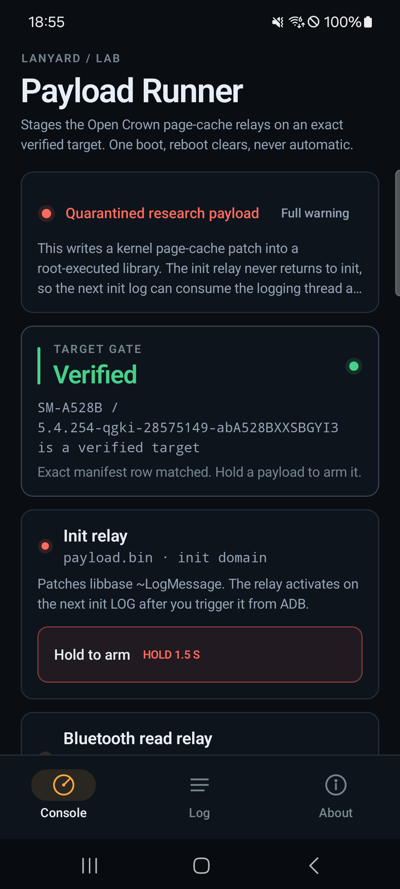
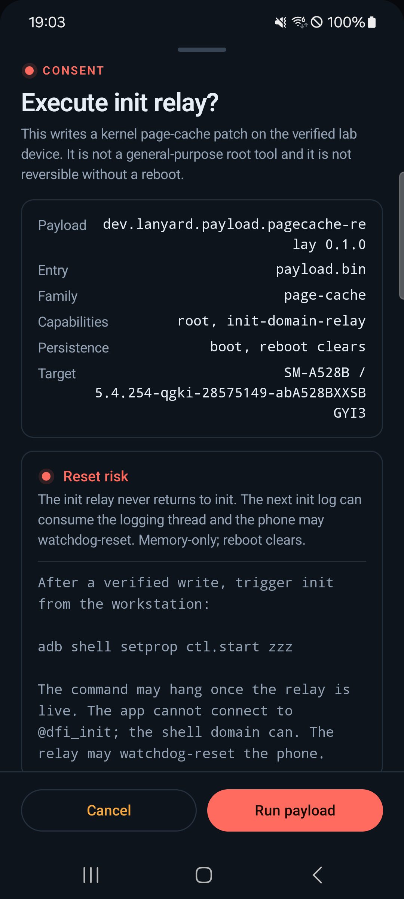
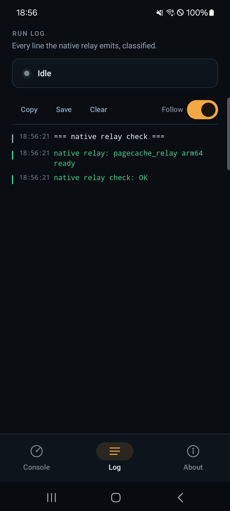
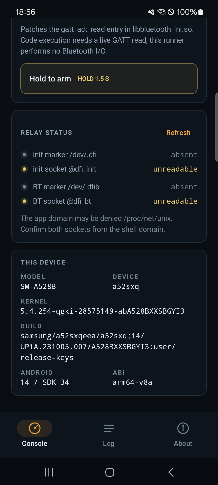
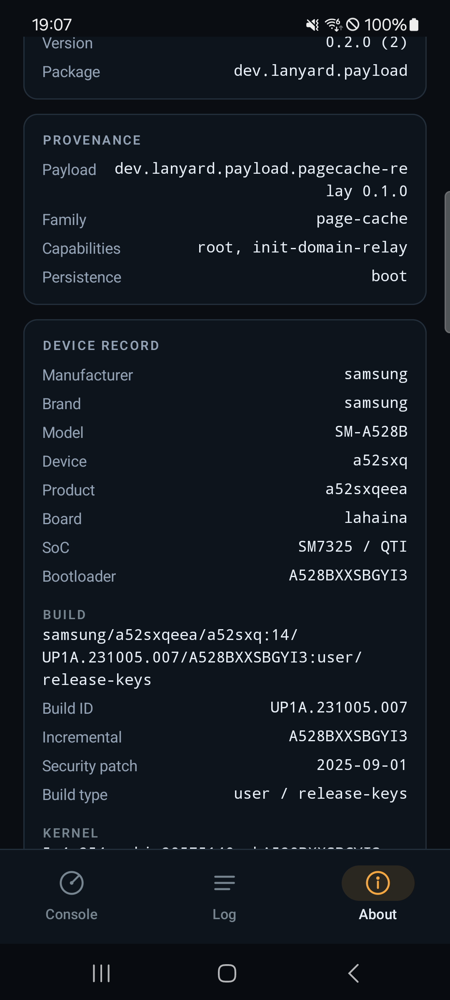
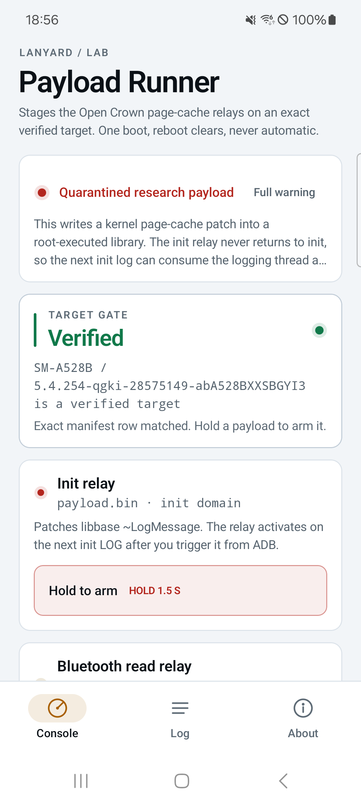

# Lanyard Payload Runner (lab)

A small, debug-only Android app that stages the Open Crown page-cache payloads
on an exact verified target. It is the device-side counterpart to the Lanyard
tether, **not** part of the MCP server or its policy surface.

- package: `dev.lanyard.payload`
- version: `0.2.0` (versionCode 2)
- APK: `app/build/outputs/apk/debug/app-debug.apk`
- installed and launched on the A52 on 2026-11-24 (Europe/Berlin)
- signed with the local Android debug certificate
- arm64-v8a, minSdk 33, targetSdk 36

Part of the [Lanyard research bench](../docs/RESEARCH.md): every attempt is
logged in [`docs/RESEARCH_LOG.md`](../docs/RESEARCH_LOG.md), every payload is
registered in [`docs/PAYLOADS.md`](../docs/PAYLOADS.md), and every measured claim
has an entry in [`docs/evidence/`](../docs/evidence/).

> This is quarantined research code. It writes a kernel page-cache patch into a
> root-executed library. The init relay never returns to init, so the next init
> log can consume the logging thread and the phone may watchdog-reset. The patch
> is memory-only and disappears at reboot. Only run it on the verified lab
> device, with a recovery path.

## What it executes

The app packages two 576-byte payloads and the native relay from Open Crown:

| Entry | Target | Effect |
| --- | --- | --- |
| `payload.bin` | `/system/lib64/libbase.so` `_ZN7android4base10LogMessageD2Ev` | Stages the init-domain relay. It activates on the next init `LOG()`. |
| `payload_bt_read.bin` | `/apex/com.android.btservices/lib64/libbluetooth_jni.so` `_Z13gatt_act_readP10tGATT_CLCBt` | Stages the Bluetooth-domain payload. It needs a live GATT read to execute. |

Both are for **one boot**. The app does not persist, does not write a partition
or boot image, and does not trigger either payload.

The exact verified row is:

```text
model   SM-A528B (a52sxq)
build   A528BXXSBGYI3
kernel  5.4.254-qgki-28575149-abA528BXXSBGYI3
android 14 / SDK 34
abi     arm64-v8a
```

A device that matches only the specification is shown as **Compatible, untested**
and the arm controls stay inert.

## Safety gates

1. **Exact target match.** The manifest row must say `verified`; model, device,
   build and kernel are all compared. There is no override switch and no
   runtime payload input. The ABI, SDK floor and kernel-family checks now run
   *before* any verified row, so a verified entry can never mask an unsupported
   ABI, SDK or kernel.
2. **Two deliberate gestures.** Nothing happens on a tap. The operator presses
   and holds a payload row for 1.5 s (the bar charges and the phone haptics at
   full charge), then confirms in a consent sheet that lists the payload id,
   version, family, capabilities, persistence, the target and the reset risk.
3. **No automatic execution.** Opening the app, changing a tab, refreshing the
   relay status or probing the native relay never runs a payload.
4. **No trigger inside the app.** The app cannot set `ctl.*`/`debug.*`
   properties and cannot perform a GATT read for the Bluetooth target. It shows
   the ADB trigger and leaves it to the operator.
5. **No generic shell.** There is no remote command interface, no network
   service, no foreground daemon, and no arbitrary file execution.
6. **Non-writing probe.** `Probe native relay` loads the arm64 library and calls
   a function that returns a fixed string. It never opens a target.
7. **One run at a time.** The run engine refuses a second run while one is in
   flight; the log cannot be cleared mid-run.

The app cannot connect to `@dfi_init` from `untrusted_app`; that is the measured
Open Crown K2a blocker, not a bug in the runner. `@dfi_bt` is expected to sit
behind the same SELinux boundary, but it could not be reached without a
Bluetooth-domain execution. The relay is consumed from the shell domain. The
relay card therefore often says `unreadable` for `/proc/net/unix`; use the shell
to confirm the socket.

## The 0.2.0 redesign

The 0.1.x build was a single `Activity` of hand-built `LinearLayout`s. 0.2.0 is a
Jetpack Compose app with the same payloads, the same native relay and the same
gates.

| | 0.1.0 | 0.2.0 |
| --- | --- | --- |
| UI | framework Views, ~600 lines of Java in one activity | Compose + Material 3, three destinations |
| State | fields on the Activity | app-scoped `RunEngine` + `StateFlow` |
| Rotation | run/log detached from the new Activity | run and log survive rotation and tab switches |
| Arming | one tap → dialog | hold-to-arm → consent sheet |
| Log | one `TextView` of raw text | structured entries, level-classified, copy/save |
| Provenance | footer note | About tab: device record, hashes, manifest, limits, utilities |
| Device identity | six fields in one card | full record: manufacturer, product, board, SoC, bootloader, build id, incremental, security patch, type/tags, app domain, copyable |
| Theme | light only | follows the system; both themes designed |
| Icon | one flat vector | adaptive icon with a monochrome variant |

<p>
  
  
  
</p>
<p>
  
  
  
</p>

### Layout

```text
dev.lanyard.payload
├── DeviceFacts.java             device snapshot (unchanged logic)
├── PayloadManifest.java         manifest parse + match (gating order tightened)
├── PageCacheChain.java          IPsec/UDP + JNI entry point (unchanged logic)
├── LanyardApp.kt                owns the RunEngine
├── MainActivity.kt              edge-to-edge Compose host
├── engine/
│   ├── RunController.kt         one-run state machine + log ring buffer
│   ├── RunEngine.kt             app-scoped: manifest, relay probe, last_run.json
│   ├── RelayStatus.kt           marker + abstract-socket probe
│   ├── LastRunStore.kt          files/last_run.json writer
│   └── LogEntry.kt              entry model + line classifier
└── ui/
    ├── AppShell.kt              bottom navigation, snackbar, effects
    ├── console/                 gate hero, payload cards, consent sheet
    ├── log/                     structured log, copy/save, follow
    ├── about/                   device record, provenance, hashes, limits, utilities
    ├── components/              instrument cards, LEDs, hold-to-arm
    └── theme/                   tokens, colours, type, shapes
```

## Build

The build reuses the self-contained Open Crown toolchain (JDK 21, Gradle
8.14.3, SDK 36, build-tools 36.0.0, NDK 27.0.12077973, CMake 3.22.1).

```sh
cd device-app
cat > local.properties <<'EOF'
sdk.dir=/absolute/path/to/android-sdk
EOF
export JAVA_HOME=/absolute/path/to/jdk
export GRADLE_USER_HOME=/absolute/path/to/gradle-home
./gradlew :app:assembleDebug
```

Compose is pinned to 1.9.1 / Material 3 1.3.2 / Kotlin 2.2.20 because those are
the newest versions AGP 8.13.2 accepts at compileSdk 36. With a warm Gradle
cache the whole build works offline:

```sh
./gradlew :app:assembleDebug :app:testDebugUnitTest --offline
```

A cold cache needs network for the first resolution (`lifecycle-common-jvm` and
`kotlinx-coroutines-android` in particular).

On this workstation the exact build was:

```sh
export JAVA_HOME=/Users/felix/Documents/Development/open-crown/.toolchain/jdk/Contents/Home
export GRADLE_USER_HOME=/Users/felix/Documents/Development/open-crown/.gradle-home
./gradlew :app:assembleDebug
```

## Tests

26 JVM tests; no device and no emulator required.

```sh
./gradlew :app:testDebugUnitTest
```

| Suite | Covers |
| --- | --- |
| `PayloadManifestMatchTest` | verified / compatible / unsupported paths, wrong model, wrong kernel, wrong build, unsupported ABI, SDK floor, invalid pattern, empty device row |
| `RunControllerTest` | verified, unverified and throwing runs, entry selection, second-run refusal, log cap and drop count, clear refusal mid-run, one finish callback |
| `LogClassifierTest` | ok / fail / info classification, including "did not report a verified write" failing closed |
| `RunnerUiStateTest` | arming requires a verified gate and no run in flight |

## Install and launch

```sh
adb -s R5CR916B48N install --no-streaming -r -g app/build/outputs/apk/debug/app-debug.apk
adb -s R5CR916B48N shell am start -W -n dev.lanyard.payload/.MainActivity
```

`--no-streaming` is used on this workstation: streaming installs fail silently
against the A52 with this ADB version.

The debug APK is 26.1 MB (24.9 MiB) because Compose is unstripped in debug.
SHA-256 of the 0.2.0 debug build:

```text
ae2e65d9ab4daaca143b54f23249d0d79951eb2384a111dee3753b02f2a8fa8c  app-debug.apk
```

It still contains only the app, the relay and the two payloads:

```text
lib/arm64-v8a/libpagecache_relay.so
assets/payloads/dev.lanyard.payload.pagecache-relay/manifest.json
assets/payloads/dev.lanyard.payload.pagecache-relay/payload.bin
assets/payloads/dev.lanyard.payload.pagecache-relay/payload_bt_read.bin
```

## Running a payload

1. Open the app and confirm the gate reads **Verified**.
2. Press and hold **Hold to arm** on a payload card for 1.5 s, then lift.
3. Read the consent sheet and choose **Run payload**.
4. Wait for `Verified: 576/576 bytes` and
   `*** PAGE CACHE MODIFIED - PAYLOAD DEPLOYED ***` in the log.
5. For the init relay, trigger init from the workstation:
   `adb shell setprop ctl.start zzz`. Expect the shell to hang once the relay is
   live and the phone to reset if init's logging thread is consumed.
6. For the Bluetooth target, perform a live GATT read against a readable
   peripheral; this app does not do Bluetooth I/O.
7. Reboot to clear the patch. The status file records the last run:

```sh
adb shell run-as dev.lanyard.payload cat files/last_run.json
```

The shell-side relay client used by Open Crown's evidence is
`tools/broker-probe/` in the Open Crown checkout. It expects the fixed
4096-byte frame described in that tree's `docs/evidence/broker-probe-a52.md`
and is not bundled here.

## Observed on the A52 (2026-11-24, 0.2.0)

- `install --no-streaming -r -g` succeeded over the 0.1.0 build; `am start`
  returned `Status: ok`.
- The gate read **Verified** with the exact manifest row, and the device card
  read `SM-A528B / a52sxq`, build `A528BXXSBGYI3`, kernel
  `5.4.254-qgki-28575149-abA528BXXSBGYI3`, Android 14 / SDK 34, arm64-v8a.
- `Probe native relay` returned `native relay: pagecache_relay arm64 ready`,
  proving the arm64 JNI load and the callback path into the structured log.
- The hold gesture opened the consent sheet; it listed payload, entry, family,
  capabilities, persistence and target.
- Both themes render on the device; landscape reflows without a crash.
- `/dev/.dfi` and `/dev/.dfib` were absent throughout, and no payload was
  triggered.
- **The page-cache write was deliberately not executed.** The first run is a
  user gesture on the consent sheet. It can reset the phone; do not arm it while
  the phone is needed.

## Provenance

Vendored from Open Crown at commit `fcaadff4c1a75da05ba0cb1736f69d0037d239ef`
(MIT):

- `payloads/org.opencrown.payload.pagecache-relay/manifest.json`
- `payloads/org.opencrown.payload.pagecache-relay/payload.bin`
- `payloads/org.opencrown.payload.pagecache-relay/payload_bt_read.bin`

The payload is registered here as `dev.lanyard.payload.pagecache-relay`: the
upstream id is kept in the manifest `upstream` block and in
[`docs/payloads/`](../docs/payloads/dev.lanyard.payload.pagecache-relay.md), but
the artifact is first-party and lives under this repository's namespace.
- `app/src/main/cpp/pagecache_relay/pagecache_relay.c`

Changes from upstream, all visible in the vendored source:

- JNI entry renamed from `Java_org_opencrown_app_root_PageCacheRelayChain_nativeExploit`
  to `Java_dev_lanyard_payload_PageCacheChain_nativeExploit`;
- logcat tag changed from `DIRTY_FRAG` to `LanyardPayload`;
- crash-log path changed to this app's private directory;
- a non-writing `nativeProbe` entry point added;
- in 0.2.0, `PayloadManifest.match()` checks the ABI, SDK floor and kernel
  pattern before it considers a verified row, so an unsupported device can never
  be reported as verified;
- in 0.2.0, `DeviceFacts`, `PayloadManifest` and `PageCacheChain` were made
  public (visibility only) so the Kotlin engine and unit tests can use them;
- in 0.2.0, the payload id and asset directory moved from
  `org.opencrown.payload.pagecache-relay` to
  `dev.lanyard.payload.pagecache-relay`; the manifest keeps the upstream id in
  its `upstream` block. Payload bytes are unchanged.

No CVE is claimed for this payload: Open Crown published it as a research
artifact and no advisory is attributed. The position, and what would be required
to change it, is recorded in [`docs/CVES.md`](../docs/CVES.md#devlanyardpayloadpagecache-relay---no-cve-claimed).

The exploit logic, payload bytes and target-selection rules are otherwise
unchanged. The research and hardware evidence live in Open Crown:

- `docs/04-payload-system.md`
- `docs/evidence/a52-app-chain.md`
- `docs/evidence/a52-bt-domain-target.md`
- `docs/evidence/broker-probe-a52.md`

Payload hashes, as recomputed by the About tab from the packaged assets:

```text
48d294ce335cf99f59b6b3031ed3741a033556ac55a445f122aea695b630ba43  payload.bin
9eac4674ae8a092991fe3c981406de6ba43be2f1a44d4dbbf51b1e29b2f1efc4  payload_bt_read.bin
```

## Limits

- One verified device row. This is not a general-purpose root tool.
- The app stages; it does not consume the relay.
- The relay is an unauthenticated raw-syscall RPC that never returns to init.
  Treat it as a measured research artifact, not a product agent.
- The debug certificate is not a distribution identity.
- A release build should not ship this artifact without a separate review.
- The run path itself is exercised by unit tests against a fake executor; the
  page-cache write is not part of the automated tests, by design.
